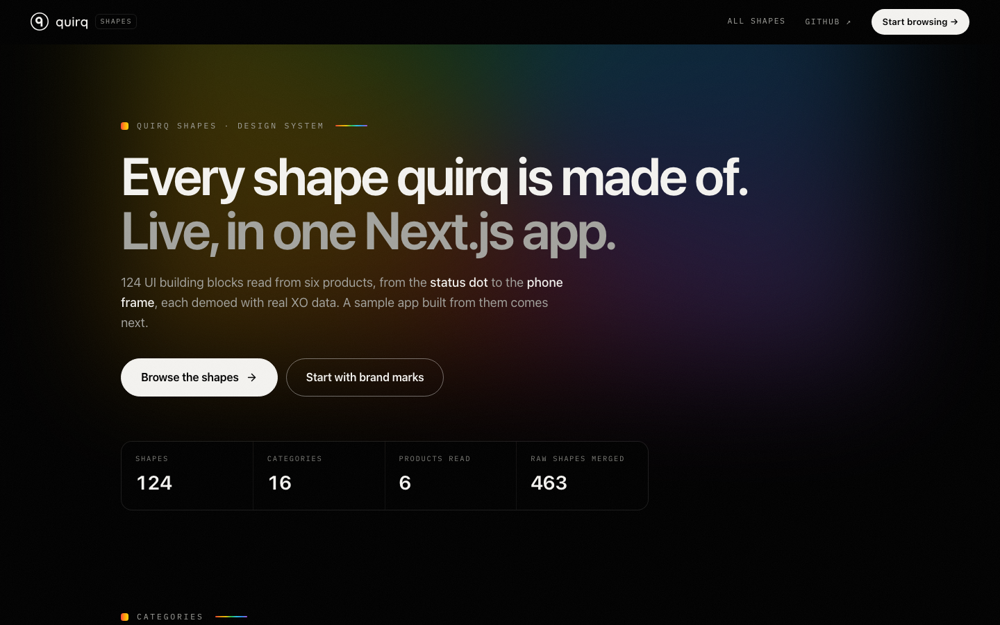
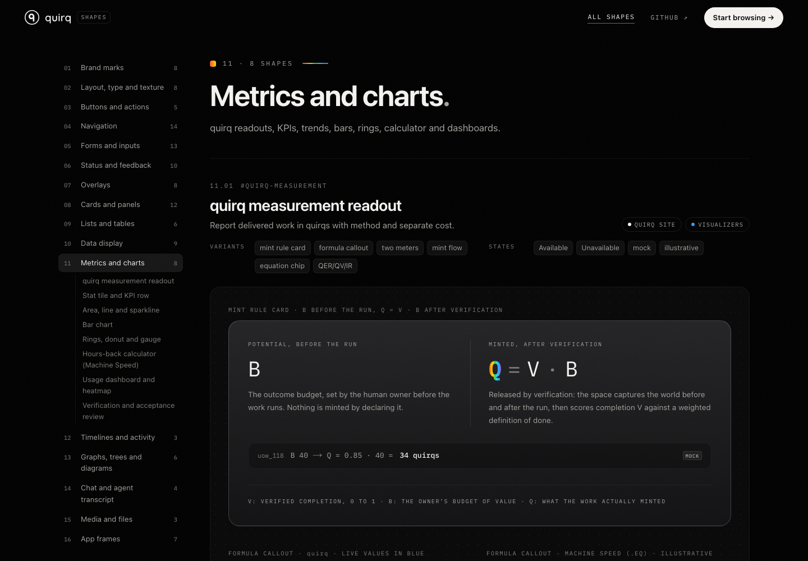

# quirq ui

Every UI component shape used across quirq products, demoed live in one Next.js app.



quirq ui is the visual catalog of the building blocks behind XO Space, XO Swarm, galileo and telescope, xo-client and the quirq site. It has **124 shapes in 16 categories**, from a status dot to a phone frame. Each shape renders every variant and state it has in the real products, uses realistic demo data, and names the screens it came from.

## What's inside

| # | Category | Shapes | Includes |
| --- | --- | --- | --- |
| 01 | [Brand marks](components/shapes/brand-marks/) | 8 | quirq wordmark and q mark, XO mark and product lockups, Spectrum accents, Sub-brand, runtime and partner lockups, Line icon set, Art plates, Shift Report and generative thumbs, Machine Speed sub-brand surface, Daylight portrait plate |
| 02 | [Layout, type and texture](components/shapes/layout/) | 8 | Section band and dividers, Eyebrow kicker and mono meta, Page header and toolbar, Hero, Grain, glow and reveal motion, Accordion and disclosure, Light and themed surfaces, Focus ring, skip link and reduced motion |
| 03 | [Buttons and actions](components/shapes/actions/) | 5 | White pill CTA, Button set, Icon button, Copy button, Keyboard hint |
| 04 | [Navigation](components/shapes/navigation/) | 14 | Top nav, Site footer, Segmented control and tabs, Filter tab chips, Sidebar and section nav, Breadcrumb, Pagination, Carousel, Arrow links and rung strip, Dock and action bar, Source and root switcher, Address bar and browser tabs, Show more and load older, Account menu |
| 05 | [Forms and inputs](components/shapes/forms-inputs/) | 13 | Text fields, Search and faceted filter, Switches, checkboxes, radio cards, Select, period and date pickers, Add and create forms, Settings form with preview, Wizard and numbered stepper, Secrets editor, Device code and QR sign-in, File dropzone, Share and access, Range slider, Budget B setter |
| 06 | [Status and feedback](components/shapes/status-feedback/) | 10 | Status dot and pill, Badges, tags and mono chips, Object state chips, Toast, Alert banner and status strip, Empty state, Full-page notice and result, Skeletons and spinners, Progress, Error panel and crash boundary |
| 07 | [Overlays](components/shapes/overlays/) | 8 | Modal dialog, Destructive confirm and danger zone, Side sheet and detail drawer, Glass alert sheet, Dropdown and context menus, Tooltip, hover card, popover, Command palette, Guided tour and target marker |
| 08 | [Cards and panels](components/shapes/cards/) | 12 | Glass card and soft panel, Bento grid, Feature, launcher and route cards, Editorial and topic card, Agent runtime card, Pricing plan card, Billing summary, Project and app card, Project detail header, Connector card, Space control card, HUD instrument panels |
| 09 | [Lists and tables](components/shapes/lists-tables/) | 6 | Data table and ledger, Inset grouped settings list, Resource and inbox rows, Numbered and hairline lists, Issue board, Todo checklist and task card |
| 10 | [Data display](components/shapes/data-display/) | 9 | Definition grid, Article and markdown prose, Terminal, logs and code, Instrument readouts and legends, Rollout matrix, Avatars and group, Provenance label and method footnote, Local vs sent trust panel, Term card with use and avoid |
| 11 | [Metrics and charts](components/shapes/metrics-charts/) | 8 | quirq measurement readout, Stat tile and KPI row, Area, line and sparkline, Bar chart, Rings, donut and gauge, Hours-back calculator (Machine Speed), Usage dashboard and heatmap, Verification and acceptance review |
| 12 | [Timelines and activity](components/shapes/timelines-activity/) | 3 | Activity feed, Pipeline and stage stepper, Timeline swimlanes and scrubber |
| 13 | [Graphs, trees and diagrams](components/shapes/graphs-trees/) | 6 | Knowledge and session graph, Radial orbit map, File tree and explorer, Flow and architecture diagram, Sequence and decision diagram, Improvement loop diagram |
| 14 | [Chat and agent transcript](components/shapes/chat-threads/) | 4 | Chat thread, Tool call and turn markers, Chat composer, Chat history |
| 15 | [Media and files](components/shapes/media-files/) | 3 | File viewer, Framed screenshot, App icon launcher |
| 16 | [App frames](components/shapes/app-frames/) | 7 | Space console shell, Sidebar app shell, Phone frame, Docking workspace, Embedded app frame, HUD cockpit frame, Sign-in screen |

Every shape page shows:

- **Purpose:** what the shape is for, in one line.
- **Seen in:** the product surfaces that ship it. Hover a chip to see the exact screens.
- **Variants and states:** the spec, listed above the demo.
- **A live demo:** every variant and state, interactive where the real one is (menus open, dialogs trap focus, tables sort, charts show tooltips).



## Where the shapes come from

The catalog was built by reading the UI source of six product surfaces and merging 463 raw shapes into 124:

| Surface | Source | Color in the catalog |
| --- | --- | --- |
| quirq site | `quirq/landing` | ink |
| XO Space | `xo-space/space_ui` | orange |
| XO Swarm | `xo-swarm` | green |
| galileo · telescope | `galileo` | cyan |
| xo-client | `xo-client-mvp` | purple |
| visualizers | `xo-projects-visualizer`, `space-drift` | blue |

## Quick start

Requires Node 20.9 or newer and pnpm.

```sh
pnpm install
pnpm dev          # http://localhost:4310
```

| Command | What it does |
| --- | --- |
| `pnpm dev` | Development server on port 4310. |
| `pnpm build` | Production build. Every page is prerendered as static HTML. |
| `pnpm start` | Serves the production build on port 4310. |
| `pnpm typecheck` | TypeScript, no emit. |
| `pnpm lint` | ESLint with the Next.js core web vitals and TypeScript rules. |
| `pnpm check` | Confirms all 124 shapes are registered and no file uses an em or en dash. |

## Deploy

The app needs no environment variables, database or API. Every route is static, so any Next.js host works. On Vercel, import `quirq-ai/ui` and keep the defaults: framework Next.js, root directory `/`, install `pnpm install`, build `pnpm build`.

## Routes

| Route | Page |
| --- | --- |
| `/` | Home: counts, the 16 categories and the six source products. |
| `/shapes` | Index of every shape, searchable and filterable by product. |
| `/shapes/<category>` | One category: every shape with its spec and live demo. Each shape has an anchor, for example `/shapes/status-feedback#toast`. |

## Project structure

```text
app/
  (catalog)/             home, index and category pages, with the site nav and footer
  globals.css            quirq design tokens and brand utilities
components/
  brand/                 quirq mark, wordmark, lockup and eyebrow kicker
  ui/                    shared primitives: buttons, badges, status, panels, fields, tooltips, logos
  shapes/<category>/     one folder per category: reusable components, their demos, and index.tsx
  site/                  catalog chrome: nav, footer, shape frame, category rail, search
lib/
  fixtures.ts            deterministic demo data: spaces, projects, sessions, runtimes, usage, quirq readings
  format.ts              number, date and duration formatters with a fixed locale and UTC
  registry.ts            assembles categories from components/shapes/*/index.tsx
  category-meta.ts       category order, titles and blurbs
  expected-shapes.json   the canonical list of shape ids per category
public/                  favicon, brand SVGs and runtime or integration logos
scripts/check-shapes.mjs catalog check used by `pnpm check`
```

Each shape is a reusable, prop-driven component that sits next to its demo (for example `components/shapes/metrics-charts/trend-chart.tsx` and `trend-chart-demo.tsx`). Demos feed it from `lib/fixtures.ts`, so the same components can be used to build real screens.

## Add or change a shape

1. Build the component and its demo in `components/shapes/<category>/`. Use the primitives in `components/ui/` and data from `lib/fixtures.ts`.
2. Register it in that folder's `index.tsx`, in the `shapes` array: `id`, `name`, `purpose`, `seenIn` (as `surface:screen`), `variants`, `states` and `Demo`.
3. Add the id to `lib/expected-shapes.json`.
4. Run `pnpm check`, `pnpm typecheck`, `pnpm lint` and `pnpm build`.

## Brand and writing rules

- **Look:** black ground, ink text, the seven-hue spectrum in small doses (eyebrow chip, hairlines, bullets), white pill call to action, glass cards for featured surfaces, 4% film grain. Tokens are in `app/globals.css`.
- **Type:** the system grotesque for body text, IBM Plex Mono for kickers, labels and numbers, Quicksand for the quirq logotype.
- **Words:** XO is the product. A space is the work environment. quirq is only the unit-of-work metric, always lowercase (Q = V · B); tokens, credits and cost are never quirqs. Missing measurements read "Unavailable", never 0. Mock and illustrative numbers are labelled as such.
- **Copy:** sentence case, plain words, no em or en dashes. Use a colon, comma, period or " · " instead.
- **Data:** demo people are fictional and emails use example.com. Demo data is seeded and deterministic, with no network requests, so server and client render the same markup.
- **Access:** semantic HTML, labelled controls, keyboard support (Escape closes overlays), visible focus rings, and reduced motion respected.

## Status

The catalog is complete: all 124 shapes are built, reviewed against their product source, and checked at desktop and phone widths.

Next is a sample app built only from these shapes: an XO Space product page and a space dashboard (overview, projects, sessions, inbox, chat, setup, telescope, phone, explore and wiki). Each screen will list the shapes it uses and link back to the catalog.
